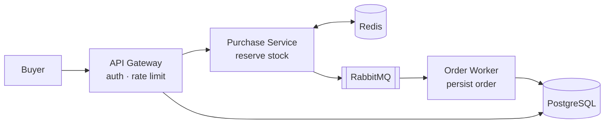

# Flash Sale Engine

A Go microservices backend for **flash sales**: short sales where a small amount
of stock meets far more buyers than it can serve.

The engine answers every buyer immediately, **never oversells**, and **never
creates the same order twice**, even under heavy concurrent load.

## How it works

Every buyer competes for one number, the remaining stock. Locking that row in
the database for every request is too slow, and loosening the lock risks
overselling. The engine splits each purchase into two paths:

- **Fast path:** stock is checked and decremented in **Redis** by a single Lua
  script. Redis runs the script atomically, so the counter can never go below
  zero. The buyer gets an answer straight away.
- **Durable path:** the accepted order goes onto a **RabbitMQ** queue. A worker
  then writes it to **PostgreSQL** and deducts the durable stock in the same
  transaction.



| Service | Responsibility |
| :--- | :--- |
| `api-gateway` | Public entry point: signup/login (JWT), rate limiting, forwarding purchases, reading and cancelling orders |
| `purchase-service` | Internal hot path: idempotency check, atomic stock reservation in Redis, publishing the order event |
| `order-worker` | Consumes order events and persists them to PostgreSQL |
| `common` | Code shared by the services: config helpers, models, response envelope, Postgres and RabbitMQ setup |

## Key guarantees

- **No overselling.** Stock is reserved atomically in Redis, and PostgreSQL
  has a `stock >= 0` constraint as a second safeguard.
- **No duplicate orders.**
  - A short-lived Redis claim per (buyer, product), set with `SETNX`, rejects a
    double-submitted purchase with `409`.
  - The worker inserts orders with `ON CONFLICT (id) DO NOTHING`, so a message
    that RabbitMQ delivers twice is stored once.
- **No lost stock.** If an order cannot be queued, its stock reservation and
  idempotency claim are rolled back.
- **Exactly-once cancellation.** Stock is returned only by the request that
  actually changes the order's status.
- **Private orders.** Every order query is filtered by the authenticated buyer.

## Tech stack

Go 1.23 · Gin · Redis 7 · RabbitMQ 3 · PostgreSQL 17 · JWT · Docker Compose ·
GitHub Actions

## Getting started

Requirements: Go 1.23+ and Docker with Compose v2.

```bash
git clone https://github.com/albert4183r7/Flash-Sale-Engine.git
cd Flash-Sale-Engine/flashsale
cp .env.example .env
```

Fill in the four blank values in `.env`:

- `POSTGRES_PASSWORD` and `RABBITMQ_PASSWORD`: any value you choose.
- `JWT_SECRET` and `INTERNAL_API_TOKEN`: generate each with `openssl rand -hex 32`.

Then start everything and add demo data:

```bash
docker compose up --build          # infrastructure + the three services
cd scripts && go run .             # seeds demo products and users, prints product IDs
curl http://localhost:8080/health
```

## API

| Method | Path | Auth | Purpose |
| :--- | :--- | :--- | :--- |
| `POST` | `/auth/signup` | – | Register an account |
| `POST` | `/auth/login` | – | Get a JWT |
| `POST` | `/purchase` | Bearer | Buy a product: `{"product_id": "...", "qty": 1}` |
| `GET` | `/orders/:id` | Bearer | Read one of your orders |
| `DELETE` | `/orders/:id` | Bearer | Cancel one of your orders and return its stock |
| `GET` | `/health` | – | Health check |

A successful purchase returns `202 Accepted` with an `order_id` and status
`PENDING`. The status becomes `SUCCESS` once the worker has stored the order.
Sold out and duplicate requests return `409`.

## Project structure

```
flashsale/
├── api-gateway/        public HTTP API
├── purchase-service/   stock reservation + event publishing
├── order-worker/       queue consumer + order persistence
├── common/             shared packages
├── e2e/                end-to-end tests that run the real service binaries
├── migrations/         database schema
├── scripts/            demo data seeder
└── deployments/        Dockerfiles
```

## Testing

```bash
cd flashsale/<module> && go test -race ./...
```

Unit tests run without any infrastructure. Integration and end-to-end tests run
when `POSTGRES_URL`, `REDIS_ADDR` and `RABBITMQ_URL` are set, and skip
otherwise. CI (`.github/workflows/ci.yml`) runs everything, including a test
where 60 concurrent buyers compete for 15 units and exactly 15 orders are
created.

## License

MIT — free to use for portfolio or personal projects.
